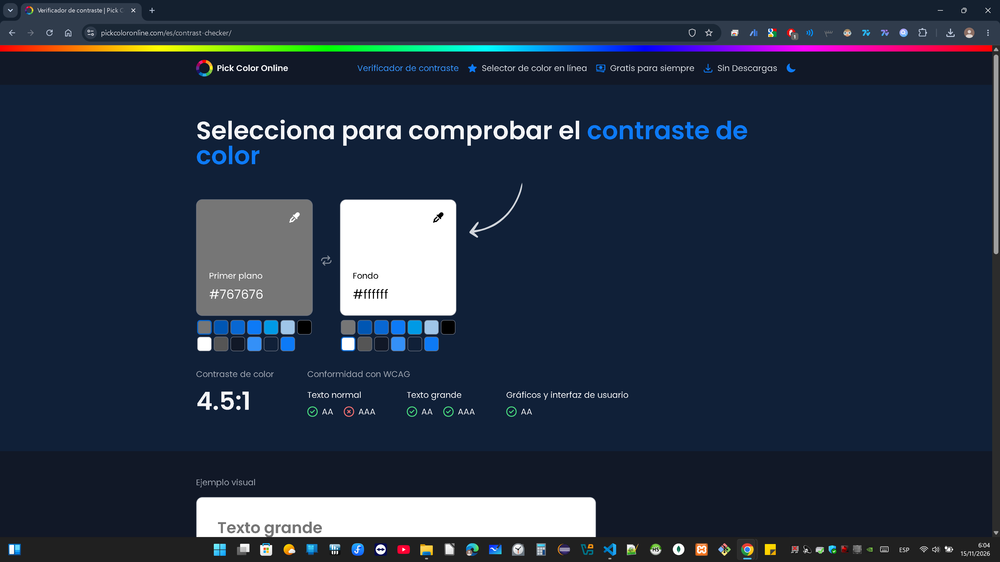
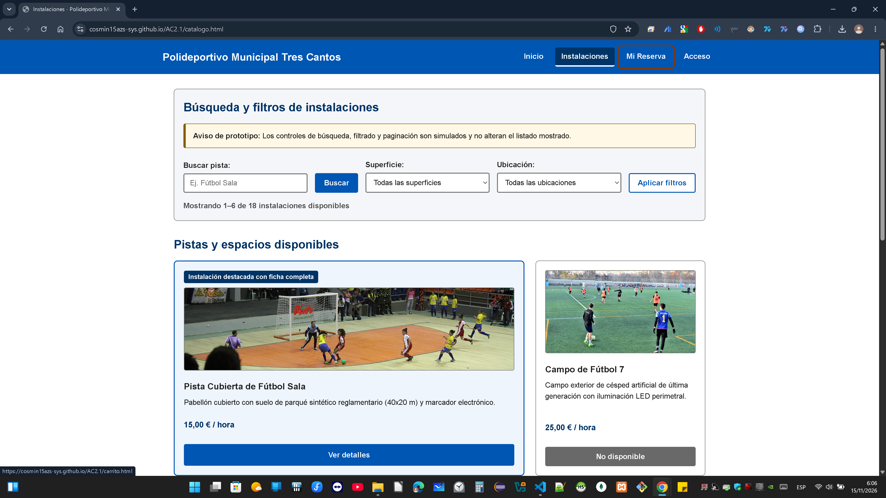
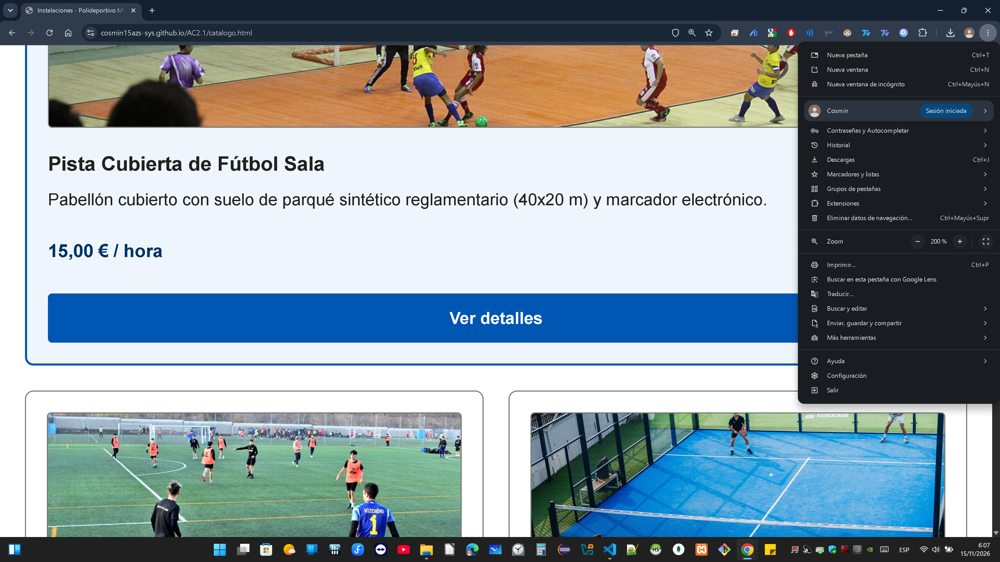

# Comprobación de Accesibilidad (RA5)

Este documento recoge las verificaciones de accesibilidad WCAG 2.1 Nivel AA realizadas sobre la web, incluyendo los problemas detectados en la primera revisión y las correcciones aplicadas.

| Aspecto | Página / Elemento | Método utilizado | Problema detectado y corrección aplicada |
| :--- | :--- | :--- | :--- |
| **Estructura y encabezados** | `catalogo.html`, `carrito.html`, todas las páginas | Revisión manual del árbol HTML | **Problema inicial:** En el catálogo se saltaba de `<h1>` a `<h3>` porque las secciones no tenían `<h2>`. **Corrección:** Se añadieron encabezados `<h2>` descriptivos en todas las secciones (`Búsqueda y filtros`, `Pistas disponibles`, `Mi Reserva`) y se mantuvo `lang="es"` y `<title>` único por página. |
| **Alternativas textuales** | `catalogo.html`, `detalle.html` | Inspección de atributos `alt` | **Corrección:** Se ajustaron las descripciones `alt` para reflejar fielmente la imagen real de la pista cubierta de parqué sintético y del resto de instalaciones. |
| **Formularios e instrucciones** | `login.html`, `formulario.html` | Revisión de etiquetas y teclado | **Problema inicial:** Faltaba indicar obligatoriedad en `login.html`, faltaba `<fieldset>/<legend>` en los botones `radio` y la ayuda del teléfono solo estaba en `title`. **Corrección:** Se explicitó `(Obligatorio)` / `(Opcional)` en las `<label>`, se agruparon los `radio` con `<fieldset>` y `<legend>`, y se añadió texto visible `<small id="ayuda-telefono">` vinculado con `aria-describedby`. |
| **Teclado, orden y foco** | Navegación, controles y botones | Navegación exclusiva con tecla `Tab` | **Problema inicial:** Los botones «No disponible» seguían recibiendo foco y siendo clicables. **Corrección:** Se añadió el atributo `disabled` a los botones no operativos y se configuró `*:focus-visible` con `outline: 3px solid #8a3600` y `outline-offset: 3px`. |
| **Contraste (texto, bordes y foco)** | Botones, inputs y contorno de foco | Comprobador de contraste WCAG (`pickcoloronline`) | **Problema inicial:** El foco naranja `#ff9900` (`2,14:1`) y los bordes `#dddddd` (`1,36:1`) no alcanzaban el mínimo de `3:1`. **Corrección:** Se oscureció el foco a `#8a3600` (`6,41:1` sobre blanco) y los bordes a `#767676` (`4,54:1` sobre blanco). Los botones `#0056b3` con texto blanco mantienen `7,04:1`. |
| **Uso del color** | Menú activo, paginación y campos requeridos | Inspección visual y lectura de etiquetas | **Correcto:** El apartado actual usa fondo oscuro + borde inferior + `aria-current="page"`. La página actual en paginación usa fondo oscuro + subrayado + `aria-current="page"`. |
| **Ampliación (200%)** | `catalogo.html`, `formulario.html` | Zoom del navegador al 200% | **Correcto:** Gracias a CSS Grid (`auto-fill`, `minmax`), Flexbox (`flex-wrap`) y unidades relativas `rem`, los bloques se reordenan en una columna sin solapamientos ni scroll horizontal. |

## Evidencias visuales de comprobación

1. **Comprobación de contraste (Foco `#8a3600` y bordes `#767676` sobre `#ffffff` >= 3:1):**  
   

2. **Navegación por teclado y foco visible activo con tecla Tab:**  
   
   
3. **Ampliación del navegador al 200% sin pérdida de contenido ni solapamientos:**  
   
