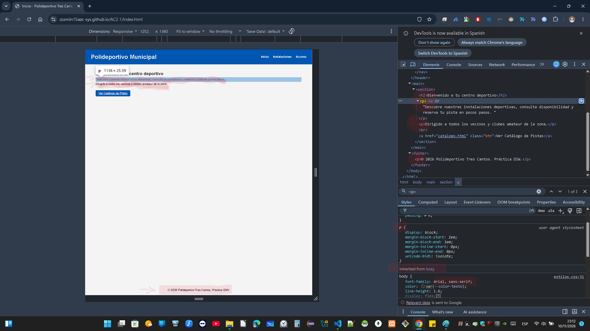
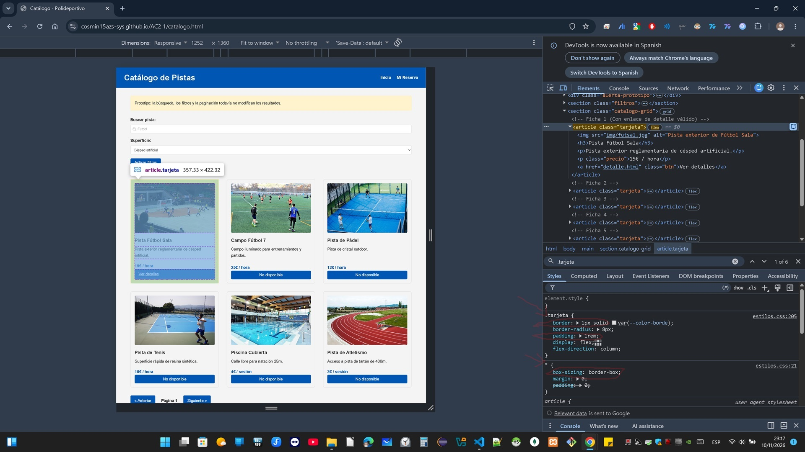
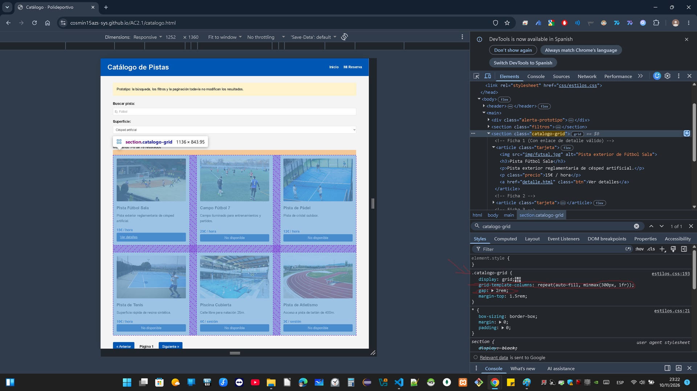

# Comprobaciones con DevTools

## 1. Herencia y cascada

**Explicación:** He comprobado cómo los párrafos (`
`) heredan la tipografía `Arial, sans-serif` y el color de texto `#333333` definidos en la regla del `body`. El inspector muestra la propiedad `Inherited from body` y el valor computado final aplicándose correctamente al elemento.

## 2. Modelo de caja

**Explicación:** He analizado la caja de una `.tarjeta` del catálogo. El diagrama muestra que tiene un `padding` de `1rem` (espacio interior) y un borde de `1px` sólido. Al usar `box-sizing: border-box` en el selector universal `*`, el tamaño final de la tarjeta incluye estos valores sin desbordar el contenedor Grid.

## 3. Distribución con Flexbox/Grid

**Explicación:** He activado el inspector de Grid en el contenedor `.catalogo-grid`. La herramienta superpone las líneas divisorias moradas y muestra cómo la propiedad `grid-template-columns: repeat(auto-fill, minmax(300px, 1fr))` crea columnas flexibles que se adaptan a la pantalla, manteniendo un `gap` (hueco) de `2rem` entre celdas.